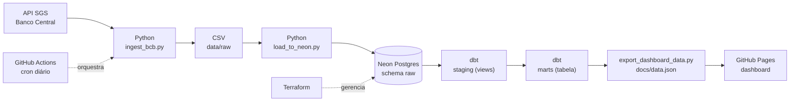

# Indicadores Econômicos do Brasil: pipeline de dados ponta a ponta

[](https://github.com/jpnovaes-data/projeto-indicadores-economicos-bcb/actions/workflows/pipeline_diario.yml)

Pipeline automatizado que coleta séries econômicas da API do Banco Central (SGS), carrega em um Postgres na nuvem, modela os dados em camadas com dbt (com testes de qualidade) e publica um dashboard público no GitHub Pages. Tudo roda sozinho todos os dias às 06h (horário de Brasília) via GitHub Actions, e a infraestrutura do banco é gerenciada como código com Terraform.

**Dashboard ao vivo:** https://jpnovaes-data.github.io/projeto-indicadores-economicos-bcb/

## Arquitetura



## Stack

| Camada | Tecnologia |
|---|---|
| Ingestão | Python (requests, pandas) com retry e backoff |
| Banco de dados | PostgreSQL 17 no Neon (região São Paulo) |
| Infraestrutura como código | Terraform (provider kislerdm/neon) |
| Transformação e testes | dbt-core + dbt-postgres |
| Orquestração, CI e deploy | GitHub Actions |
| Visualização | HTML + Chart.js, publicado no GitHub Pages |

## Fontes de dados

API pública do Banco Central, sem necessidade de chave de acesso.

| Série | Código SGS | Periodicidade |
|---|---|---|
| Dólar comercial (venda) | 1 | Diária |
| IPCA (variação mensal, %) | 433 | Mensal |
| Meta Selic (% a.a.) | 432 | Diária |
| IGP-M (variação mensal, %) | 189 | Mensal |

A API limita séries diárias a janelas de 10 anos, então a ingestão busca os últimos 9,5 anos.

## Como o pipeline funciona

1. **Ingestão** (`scripts/ingest_bcb.py`): consulta as 4 séries, trata tipos e datas e salva em CSV. Tem 3 tentativas com espera crescente para lidar com timeouts da API.
2. **Carga** (`scripts/load_to_neon.py`): cria o schema `raw` e carrega cada série com `TRUNCATE` seguido de `INSERT`.
3. **Transformação** (`dbt_economia/`): 4 views em `staging` (limpeza, tipagem, acumulado de 12 meses do IPCA) e 1 tabela em `marts`.
4. **Qualidade**: 10 testes dbt (`unique` e `not_null` em todas as chaves de data) rodam a cada execução. Se algum falhar, o workflow falha e o dashboard não é republicado.
5. **Exportação** (`scripts/export_dashboard_data.py`): lê `marts.fato_indicadores_economicos` e gera `docs/data.json`.
6. **Publicação**: o job de deploy envia a pasta `docs/` para o GitHub Pages.

### Modelo de dados

```
raw.cambio_dolar | raw.ipca | raw.selic | raw.igpm
        |
staging.stg_cambio_dolar | stg_ipca | stg_selic | stg_igpm   (views)
        |
marts.fato_indicadores_economicos                              (tabela, 1 linha por mês)
```

O mart consolida tudo na granularidade mensal: dólar e Selic (diários) viram média, mínimo e máximo do mês, e IPCA e IGP-M (mensais) entram direto.

## Infraestrutura como código

O projeto Neon foi criado pelo console e depois **importado** para o Terraform (`terraform import`). O primeiro `plan` mostrou uma substituição do recurso (destroy e create) por divergências de `pg_version` e `region_id`, então o código foi ajustado para refletir a realidade antes de qualquer `apply`. Hoje o `plan` retorna "No changes".

## CI/CD

O workflow `.github/workflows/pipeline_diario.yml` roda diariamente às 09:00 UTC (06:00 em Brasília) e também sob demanda (`workflow_dispatch`). Ele tem dois jobs:

- **pipeline**: ingestão, carga, `dbt run`, `dbt test` e exportação dos dados.
- **deploy**: publica o dashboard no GitHub Pages, e só roda se o job anterior passar.

Credenciais ficam em GitHub Secrets e o `profiles.yml` do dbt é gerado em tempo de execução. Nada sensível vai para o repositório.

## Dashboard

Página estática com KPIs (dólar, Meta Selic, IPCA acumulado em 12 meses e IGP-M), evolução do dólar com banda de mínimo e máximo, Meta Selic, IPCA mensal junto do acumulado em 12 meses e IGP-M. Cada KPI mostra o último mês com dado daquela série, já que cada indicador é divulgado em um ritmo diferente. Tem tema claro e escuro automático.

### Por que GitHub Pages e não Power BI

A primeira ideia era usar Power BI como camada de apresentação. Optei por um dashboard estático pelos seguintes motivos:

- **Acesso imediato**: quem abre o link vê os dados na hora, sem login, licença ou instalação.
- **Automação completa**: o dashboard é atualizado pelo mesmo pipeline que gera os dados. No Power BI, atualização agendada e compartilhamento público dependem do Power BI Service e de licenças à parte.
- **Tudo versionado**: a página é código (HTML e JavaScript) e pode ser revisada no Git. Um arquivo `.pbix` é binário e difícil de revisar.
- **Sem credenciais expostas**: a página lê apenas um JSON estático, sem conexão com o banco.

A camada `marts` continua pronta para ser consumida por Power BI ou qualquer outra ferramenta de BI, se for necessário.

## Decisões técnicas e aprendizados

- **TRUNCATE em vez de DROP**: a primeira versão da carga usava `if_exists="replace"` do pandas, que executa `DROP TABLE`. Depois do primeiro `dbt run`, o Postgres passou a bloquear o drop porque as views de staging dependem das tabelas `raw`. O erro apareceu na primeira execução do GitHub Actions. A correção foi manter a tabela e trocar por `TRUNCATE` e `INSERT`.
- **Importar, não recriar**: adotar a infraestrutura existente via `terraform import` preserva os dados e evita destruir o banco.
- **Granularidade mensal no mart**: evita duplicar valores de séries mensais ao cruzar com séries diárias.
- **Segredos fora do Git**: `.env`, `*.tfstate` (que contém a senha do banco) e os artefatos do dbt estão no `.gitignore`.
- **Acumulado de 12 meses só quando completo**: nos primeiros 11 meses da série a janela tem menos de 12 valores, então a exportação descarta esses pontos em vez de exibir um acumulado enganoso.

## Limitações e próximos passos

- Carga em full refresh a cada execução. Com este volume é barato, mas o próximo passo é carga incremental.
- O IPCA acumulado em 12 meses usa soma simples das variações mensais. O correto é o acumulado composto.
- A coluna `selic_ao_dia` nos modelos dbt guarda a meta Selic em % ao ano (série 432) e deve ser renomeada.
- State do Terraform local. Migrar para backend remoto.
- Testes dbt cobrem apenas unicidade e nulos. Faltam testes de frescor dos dados (`source freshness`) e de faixa de valores.
- Sem alertas de falha (Slack ou e-mail) no workflow.

## Como rodar localmente

Pré-requisitos: Python 3.13, um banco Postgres (ex.: projeto gratuito no Neon) e a connection string.

```bash
pip install -r requirements.txt

# credenciais (nunca commitar o .env)
cp .env.example .env
# edite o .env com sua DATABASE_URL

python scripts/ingest_bcb.py
python scripts/load_to_neon.py

# dbt: crie ~/.dbt/profiles.yml a partir de dbt_economia/profiles.yml.example
cd dbt_economia
dbt run
dbt test
cd ..

# dashboard local
python scripts/export_dashboard_data.py
python -m http.server --directory docs 8000   # abra http://localhost:8000
```

Para provisionar o banco com Terraform (opcional), exporte `NEON_API_KEY` e rode `terraform init` e `terraform plan` dentro de `terraform/`.

Para o deploy no GitHub Pages, cadastre os secrets `DATABASE_URL`, `DBT_HOST`, `DBT_USER`, `DBT_PASSWORD` e `DBT_DBNAME` e, em **Settings, Pages**, selecione **GitHub Actions** como fonte.

## Estrutura do repositório

```
.
├── .github/workflows/pipeline_diario.yml   # ingestão, dbt, testes e deploy
├── scripts/
│   ├── ingest_bcb.py                       # extração da API do BCB
│   ├── load_to_neon.py                     # carga no Postgres
│   └── export_dashboard_data.py            # mart para docs/data.json
├── dbt_economia/
│   ├── models/staging/                     # views + fontes + testes
│   ├── models/marts/                       # fato_indicadores_economicos
│   ├── macros/generate_schema_name.sql
│   └── profiles.yml.example
├── terraform/                              # projeto Neon como código
├── docs/index.html                         # dashboard (GitHub Pages)
├── requirements.txt
└── .env.example
```

## Autor

João Pedro Novaes, Analista de Dados. [LinkedIn](https://www.linkedin.com/in/jpedro-novaes)
