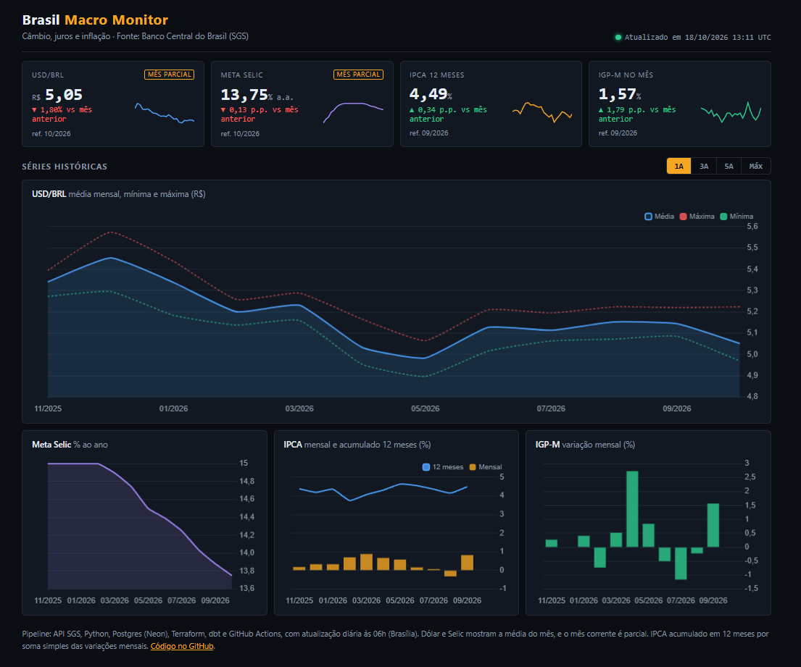
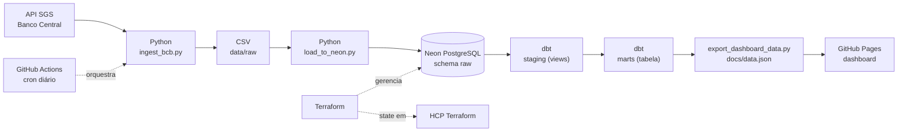

# Indicadores Econômicos do Brasil: pipeline de dados ponta a ponta

[](https://github.com/jpnovaes-data/projeto-indicadores-economicos-bcb/actions/workflows/pipeline_diario.yml)
[](https://github.com/jpnovaes-data/projeto-indicadores-economicos-bcb/actions/workflows/terraform_ci.yml)
[](https://github.com/jpnovaes-data/projeto-indicadores-economicos-bcb/actions/workflows/terraform_plan.yml)

Pipeline automatizado que coleta indicadores econômicos da API SGS do Banco Central do Brasil, carrega os dados em um PostgreSQL na nuvem, transforma e testa os modelos com dbt e publica um dashboard no GitHub Pages. Tudo roda sozinho todos os dias às 06h (horário de Brasília) via GitHub Actions.

A infraestrutura do banco é gerenciada como código com Terraform (projeto Neon), com o state armazenado remotamente no HCP Terraform.

**Dashboard ao vivo:** https://jpnovaes-data.github.io/projeto-indicadores-economicos-bcb/



## Arquitetura



O pipeline diário de dados **não executa `terraform apply`**. Mudanças de infraestrutura são planejadas, revisadas e aplicadas separadamente.

## Stack

| Camada | Tecnologia |
|---|---|
| Fonte dos dados | API SGS do Banco Central do Brasil |
| Ingestão e carga | Python (requests, pandas) |
| Banco de dados | PostgreSQL 17 no Neon (região São Paulo) |
| Infraestrutura como código | Terraform (provider kislerdm/neon) |
| State do Terraform | HCP Terraform (plano gratuito) |
| Transformação e testes | dbt-core e dbt-postgres |
| Orquestração, CI e deploy | GitHub Actions |
| Visualização | HTML, JavaScript e Chart.js no GitHub Pages |

## Fontes de dados

API pública, sem necessidade de chave de acesso.

| Indicador | Código SGS | Periodicidade |
|---|---|---|
| Dólar comercial (venda) | 1 | Diária |
| IPCA, variação mensal (%) | 433 | Mensal |
| Meta Selic (% ao ano) | 432 | Diária |
| IGP-M, variação mensal (%) | 189 | Mensal |

A API limita séries diárias a janelas de 10 anos, então a ingestão busca os últimos 9,5 anos.

## Como o pipeline funciona

1. **Ingestão** (`scripts/ingest_bcb.py`): consulta as 4 séries, trata tipos e datas e salva em CSV, com 3 tentativas e espera crescente para lidar com timeouts.
2. **Carga** (`scripts/load_to_neon.py`): cria o schema `raw` e carrega cada série com `TRUNCATE` seguido de `INSERT`.
3. **Transformação** (`dbt_economia/`): 4 views em `staging` e a tabela `marts.fato_indicadores_economicos`.
4. **Qualidade**: 10 testes dbt (`unique` e `not_null` nas chaves de data). Se algum falhar, o workflow falha e o dashboard não é republicado.
5. **Exportação** (`scripts/export_dashboard_data.py`): gera `docs/data.json` a partir do mart.
6. **Publicação**: o job de deploy envia `docs/` ao GitHub Pages, somente se o job anterior passar.

### Modelo de dados

```
raw.cambio_dolar | raw.ipca | raw.selic | raw.igpm
        |
staging.stg_cambio_dolar | stg_ipca | stg_selic | stg_igpm      (views)
        |
marts.fato_indicadores_economicos                                (tabela, 1 linha por mês)
```

Dólar e Selic (diários) viram média, mínimo e máximo do mês. IPCA e IGP-M (mensais) entram direto.

## Infraestrutura como código

O projeto Neon foi criado pelo console e depois **importado** para o Terraform. O primeiro `plan` propôs destruir e recriar o recurso por divergências em `pg_version` e `region_id`, então o código foi ajustado para refletir a realidade antes de qualquer `apply`. Hoje o plano retorna `No changes`.

- **State remoto** no HCP Terraform (workspace `projeto-economia`, execução local), em vez de um arquivo só no computador.
- **`prevent_destroy = true`** no recurso do banco, que transforma qualquer plano destrutivo em erro.
- Procedimentos de plano, importação, destruição e recuperação em [`terraform/README.md`](terraform/README.md).

## CI/CD

| Workflow | Quando roda | O que faz |
|---|---|---|
| `pipeline_diario.yml` | Diário às 06h (Brasília) e manual | Ingestão, carga, dbt run, dbt test, exportação e deploy do dashboard |
| `terraform_ci.yml` | Mudanças em `terraform/` | `fmt -check`, `init -backend=false` e `validate`, sem credenciais |
| `terraform_plan.yml` | Pull requests em `terraform/` e manual | Gera o plano contra o state remoto, somente leitura |

Nenhum workflow aplica mudanças na infraestrutura automaticamente.

## Segurança

Credenciais ficam em GitHub Secrets e em arquivos locais fora do Git, e o dashboard lê apenas um JSON estático, sem conexão com o banco. O state do Terraform é tratado como informação sensível. Detalhes, incluindo o que fazer se um segredo vazar, em [`SECURITY.md`](SECURITY.md). O Dependabot abre PRs semanais de atualização de dependências.

## Dashboard

Painel no estilo de terminais financeiros, com tema claro e escuro automático:

- Cartões de KPI (dólar, Meta Selic, IPCA acumulado em 12 meses e IGP-M) com variação contra o mês anterior e sparkline dos últimos 24 meses.
- Selo de "mês parcial" para séries diárias quando o mês corrente ainda não fechou.
- Seletor de período (1A, 3A, 5A, Máx) para os gráficos de dólar com mínimo e máximo, Meta Selic, IPCA mensal e acumulado e IGP-M.

Cada KPI mostra o último mês com dado daquela série, já que os indicadores são divulgados em ritmos diferentes.

### Por que GitHub Pages e não Power BI

- **Acesso imediato:** quem abre o link vê os dados, sem login, licença ou instalação.
- **Automação completa:** o dashboard é atualizado pelo mesmo pipeline que gera os dados.
- **Tudo versionado:** a página é código e pode ser revisada no Git, ao contrário de um `.pbix` binário.
- **Sem credenciais no navegador:** a página lê apenas `data.json`.

A camada `marts` continua pronta para ser consumida por Power BI ou outra ferramenta de BI.

## Decisões técnicas e aprendizados

- **TRUNCATE em vez de DROP:** `if_exists="replace"` do pandas derrubava as tabelas, e o Postgres bloqueava porque as views do dbt dependem delas. O erro apareceu na primeira execução do GitHub Actions.
- **Importar, não recriar:** preserva os dados e evita destruir o banco.
- **State remoto e proteção contra destruição:** reduzem o risco de perder o controle do recurso ou apagá-lo por engano.
- **Acumulado de 12 meses só quando completo:** a exportação descarta os primeiros 11 meses, em que a janela tem menos de 12 valores.
- **Segredos fora do Git:** `.env`, state e arquivos de plano estão no `.gitignore`.

## Limitações e próximos passos

- Carga em full refresh a cada execução. O próximo passo é a carga incremental.
- O IPCA acumulado em 12 meses usa soma simples das variações mensais, e o correto é o acumulado composto.
- A coluna `selic_ao_dia` nos modelos dbt guarda a meta Selic em % ao ano (série 432) e deve ser renomeada.
- Testes dbt cobrem só unicidade e nulos. Faltam frescor dos dados e faixas de valores.
- Sem alertas de falha (e-mail ou Slack) nos workflows.
- Avaliar ambientes separados de desenvolvimento e produção, se a complexidade justificar.

## Como executar localmente

Pré-requisitos: Python 3.13, um PostgreSQL acessível (por exemplo, um projeto gratuito no Neon) e Terraform 1.15 ou superior para a infraestrutura.

```bash
pip install -r requirements.txt

cp .env.example .env     # preencha DATABASE_URL (nunca commitar o .env)

python scripts/ingest_bcb.py
python scripts/load_to_neon.py

# dbt: crie ~/.dbt/profiles.yml a partir de dbt_economia/profiles.yml.example
cd dbt_economia && dbt run && dbt test && cd ..

# dashboard local
python scripts/export_dashboard_data.py
python -m http.server --directory docs 8000    # http://localhost:8000
```

Para o Terraform, siga o [runbook](terraform/README.md). Para o deploy, cadastre os secrets do pipeline de dados e, em **Settings, Pages**, selecione **GitHub Actions** como fonte.

## Estrutura do repositório

```
.
├── .github/
│   ├── dependabot.yml
│   └── workflows/
│       ├── pipeline_diario.yml
│       ├── terraform_ci.yml
│       └── terraform_plan.yml
├── scripts/
│   ├── ingest_bcb.py
│   ├── load_to_neon.py
│   └── export_dashboard_data.py
├── dbt_economia/
│   ├── models/staging/
│   ├── models/marts/
│   ├── macros/
│   └── profiles.yml.example
├── terraform/
│   ├── provider.tf
│   ├── main.tf
│   ├── outputs.tf
│   └── README.md
├── docs/
│   └── index.html          # data.json é gerado no CI e não é versionado
├── requirements.txt
├── SECURITY.md
└── .env.example
```

## Autor

João Pedro Novaes, Analista de Dados. [LinkedIn](https://www.linkedin.com/in/joão-pedro-novaes)
