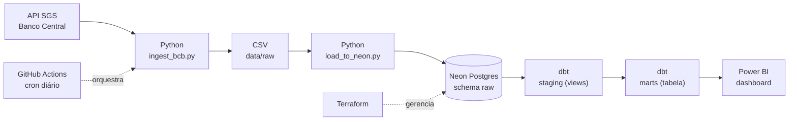

# Indicadores Econômicos do Brasil: pipeline de dados ponta a ponta

[](https://github.com/jpnovaes-data/projeto-indicadores-economicos-bcb/actions/workflows/pipeline_diario.yml)

Pipeline automatizado que coleta séries econômicas da API do Banco Central (SGS), carrega em um Postgres na nuvem, modela os dados em camadas com dbt (com testes de qualidade) e alimenta um dashboard executivo no Power BI. Tudo roda sozinho todos os dias às 06h (horário de Brasília) via GitHub Actions, e a infraestrutura do banco é gerenciada como código com Terraform.


## Arquitetura



## Stack

| Camada | Tecnologia |
|---|---|
| Ingestão | Python (requests, pandas) com retry e backoff |
| Banco de dados | PostgreSQL 17 no Neon (região São Paulo) |
| Infraestrutura como código | Terraform (provider kislerdm/neon) |
| Transformação e testes | dbt-core + dbt-postgres |
| Orquestração e CI | GitHub Actions |
| Visualização | Power BI (medidas DAX e tabela calendário em M) |

## Fontes de dados

API pública do Banco Central, sem necessidade de chave de acesso.

| Série | Código SGS | Periodicidade |
|---|---|---|
| Dólar comercial (venda) | 1 | Diária |
| IPCA (variação mensal, %) | 433 | Mensal |
| Meta Selic (% a.a.) | 432 | Diária |
| IGP-M (variação mensal, %) | 189 | Mensal |

A API limita séries diárias a janelas de 10 anos, então a ingestão busca os últimos 9,5 anos.

## Como o pipeline funciona

1. **Ingestão** (`scripts/ingest_bcb.py`): consulta as 4 séries, trata tipos e datas e salva em CSV. Tem 3 tentativas com espera crescente para lidar com timeouts da API.
2. **Carga** (`scripts/load_to_neon.py`): cria o schema `raw` e carrega cada série com `TRUNCATE` seguido de `INSERT`.
3. **Transformação** (`dbt_economia/`): 4 views em `staging` (limpeza, tipagem, acumulado de 12 meses do IPCA) e 1 tabela em `marts`.
4. **Qualidade**: 10 testes dbt (`unique` e `not_null` em todas as chaves de data) rodam a cada execução. Se algum falhar, o workflow falha.
5. **Consumo**: o Power BI conecta em `marts.fato_indicadores_economicos`.

### Modelo de dados

```
raw.cambio_dolar | raw.ipca | raw.selic | raw.igpm
        |
staging.stg_cambio_dolar | stg_ipca | stg_selic | stg_igpm   (views)
        |
marts.fato_indicadores_economicos                              (tabela, 1 linha por mês)
```

O mart consolida tudo na granularidade mensal: dólar e Selic (diários) viram média, mínimo e máximo do mês, e IPCA e IGP-M (mensais) entram direto.

## Infraestrutura como código

O projeto Neon foi criado pelo console e depois **importado** para o Terraform (`terraform import`). O primeiro `plan` mostrou uma substituição do recurso (destroy e create) por divergências de `pg_version` e `region_id`, então o código foi ajustado para refletir a realidade antes de qualquer `apply`. Hoje o `plan` retorna "No changes".

## CI/CD

O workflow `.github/workflows/pipeline_diario.yml` roda diariamente às 09:00 UTC (06:00 em Brasília) e também sob demanda (`workflow_dispatch`). Credenciais ficam em GitHub Secrets e o `profiles.yml` do dbt é gerado em tempo de execução. Nada sensível vai para o repositório.

## Dashboard

Painel executivo com KPIs (dólar, Selic, IPCA 12m, IGP-M), evolução do dólar com banda mínimo/máximo, comparação IPCA x IGP-M e inflação x juros. As medidas DAX tratam o "último mês com dado" de cada série separadamente, já que cada indicador é divulgado em um ritmo diferente, e incluem variação do dólar (mês a mês e ano a ano) e juro real aproximado.

## Decisões técnicas e aprendizados

- **TRUNCATE em vez de DROP**: a primeira versão da carga usava `if_exists="replace"` do pandas, que executa `DROP TABLE`. Depois do primeiro `dbt run`, o Postgres passou a bloquear o drop porque as views de staging dependem das tabelas `raw`. O erro apareceu na primeira execução do GitHub Actions. A correção foi manter a tabela e trocar por `TRUNCATE` e `INSERT`.
- **Importar, não recriar**: adotar a infraestrutura existente via `terraform import` preserva os dados e evita destruir o banco.
- **Granularidade mensal no mart**: evita duplicar valores de séries mensais ao cruzar com séries diárias.
- **Segredos fora do Git**: `.env`, `*.tfstate` (que contém a senha do banco) e os artefatos do dbt estão no `.gitignore`.

## Limitações e próximos passos

- Carga em full refresh a cada execução. Com este volume é barato, mas o próximo passo é carga incremental.
- State do Terraform local. Migrar para backend remoto.
- Testes dbt cobrem apenas unicidade e nulos. Faltam testes de frescor dos dados (`source freshness`) e de faixa de valores.
- Sem alertas de falha (Slack ou e-mail) no workflow.
- O arquivo `.pbix` não está versionado no repositório.

## Como rodar localmente

Pré-requisitos: Python 3.13, um banco Postgres (ex.: projeto gratuito no Neon) e a connection string.

```bash
pip install -r requirements.txt

# credenciais (nunca commitar o .env)
cp .env.example .env
# edite o .env com sua DATABASE_URL

python scripts/ingest_bcb.py
python scripts/load_to_neon.py

# dbt: crie ~/.dbt/profiles.yml a partir de dbt_economia/profiles.yml.example
cd dbt_economia
dbt run
dbt test
```

Para provisionar o banco com Terraform (opcional), exporte `NEON_API_KEY` e rode `terraform init` e `terraform plan` dentro de `terraform/`.

## Estrutura do repositório

```
.
├── .github/workflows/pipeline_diario.yml   # orquestração diária
├── scripts/
│   ├── ingest_bcb.py                       # extração da API do BCB
│   └── load_to_neon.py                     # carga no Postgres
├── dbt_economia/
│   ├── models/staging/                     # views + fontes + testes
│   ├── models/marts/                       # fato_indicadores_economicos
│   └── macros/generate_schema_name.sql
├── terraform/                              # projeto Neon como código
├── docs/dashboard.png                      # print do painel
└── requirements.txt
```

## Autor

João Pedro Novaes, Analista de Dados. [LinkedIn](https://www.linkedin.com/in/joão-pedro-novaes)
